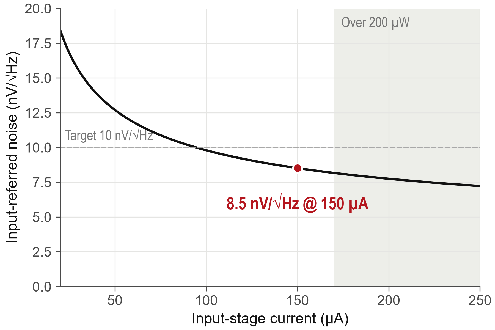

# figstyle — 같은 모양의 그래프

- matplotlib 그래프를 누가 그려도 같은 모양으로 만든다 — `import figstyle` 한 줄이면 색·선·글꼴·크기가 맞춰진다.
- 철학은 "Simple is best": 그림 하나에 주장 하나, 축 하나, 곡선 1–2 개, 빨강은 핵심 한 곳.
- Claude Code (skill) 와 ChatGPT (지시문) 에 "이 스타일로 그래프 그려줘" 라고만 해도 같은 결과가 나오게 지시문을 함께 둔다.
- 발표 자료 양식은 함께 쓰는 저장소 [simple-pt](https://github.com/Coxwoo/simple-pt-jsw).



## 목차

1. 파일 — 무엇이 어디에
2. 바로 쓰기 — Python
3. Claude Code 에서
4. ChatGPT 에서
5. 규칙 한눈에
6. 글꼴
7. 라이선스

---

## 1. 파일

| 파일 | 내용 |
|---|---|
| `figstyle.py` | 스타일의 정본 — 색·선·크기 상수, rcParams, 도우미 (`key_text`, `ref_hline`, `note`, `bars`, `freq_log_axis`, `save`) |
| `rules/graph-style.md` | 규칙과 이유 |
| `SKILL.md` | Claude Code skill |
| `CLAUDE.md` | 이 저장소를 Claude Code 로 열었을 때 |
| `chatgpt/INSTRUCTIONS.md` | ChatGPT Project 지시문과 올릴 파일 |
| `examples/` | 가짜 데이터 예시 8 개 — `make_examples.py`, 그림 `figures/` (한 줄 설명 `figures/README.md`) |

## 2. 바로 쓰기

```bash
pip install matplotlib numpy
python examples/make_examples.py
```

```python
import figstyle as fs

fig, ax = fs.plt.subplots(figsize=fs.SIZE, layout="constrained")
ax.plot(x, y, **fs.MAIN)                         # 주 결과 — 검정 실선
ax.plot(x2, y2, **fs.COMP)                       # 비교 — 파랑 점선
fs.ref_hline(ax, 10, "Target 10")                # 회색 기준선
ax.plot(xk, yk, **fs.KEY_DOT)                    # 핵심 한 곳 — 빨강 점
fs.key_text(ax, xk, yk, "8.5 @ 150", xytext=(0, -22), ha="center")
fs.save(fig, "noise_vs_current")                 # figures/noise_vs_current.png, svg/, pdf/
```

## 3. Claude Code 에서

- 모든 프로젝트에서 쓰기: 이 저장소를 skill 폴더로 받는다. 그 뒤 "figstyle 로 이 데이터 그래프 그려줘".

  ```bash
  git clone https://github.com/Coxwoo/figstyle-jsw.git ~/.claude/skills/figstyle
  ```

- 이 저장소에서만: 폴더를 Claude Code 로 열면 `CLAUDE.md` 가 `SKILL.md` 를 가리킨다.

## 4. ChatGPT 에서

- Project 를 만들고 `chatgpt/INSTRUCTIONS.md` 의 지시문을 Instructions 에 붙인 뒤, `figstyle.py`·`rules/graph-style.md`·`examples/make_examples.py` 를 올린다.
- ChatGPT 에는 Arial 이 없어 글꼴이 다르게 나온다. 최종 그림은 내 PC 에서 같은 코드로 다시 그린다.

## 5. 규칙 한눈에

| 역할 | 모양 |
|---|---|
| 주 결과 | 검정 실선 (`fs.MAIN`) |
| 비교 | 파랑 점선 (`fs.COMP`) |
| 핵심 한 곳 | 빨강 점과 굵은 숫자 (`fs.KEY_DOT`, `fs.key_text`) |
| 기준선·한계 | 회색 (`fs.ref_hline`, `fs.note`, `fs.BAND`) |

- 축 하나, 곡선 1–2 개, 회색 보조 1–3 개. 범례는 곡선이 둘일 때만. 조건 문장은 그림 밖. 6 × 4 in, 300 dpi.
- 자세히는 `rules/graph-style.md`.

## 6. 글꼴

- Arial·Arial Narrow (Windows·macOS 기본). 없으면 Liberation Sans → DejaVu Sans 로 바뀐다.
- 한글이 필요하면 Noto Sans KR·맑은 고딕 등 보통 굵기 판이 있을 때 대체 글꼴로 쓴다.

## 7. 라이선스

MIT — `LICENSE`.
